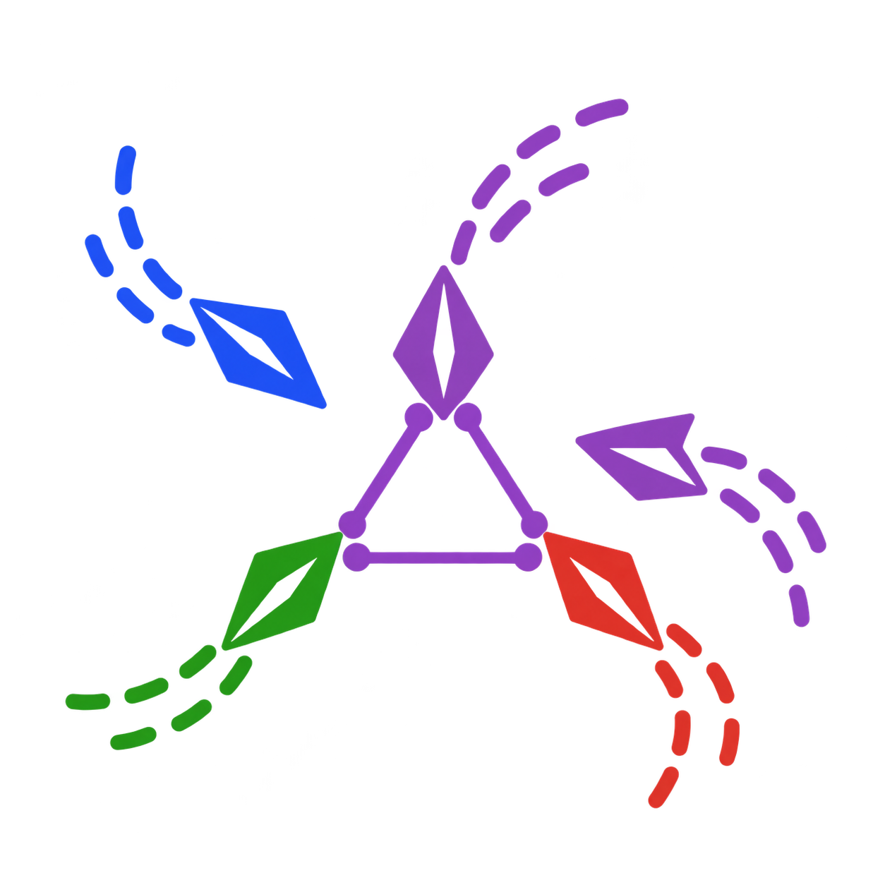
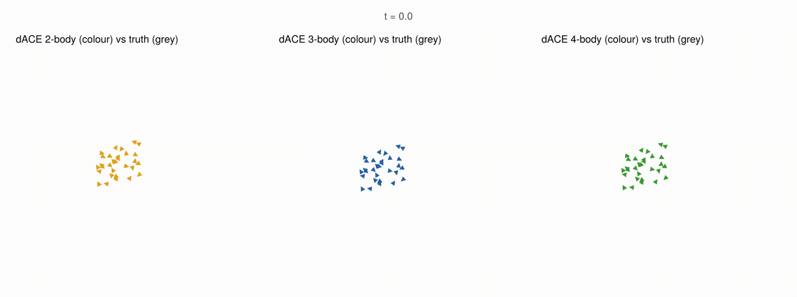

<p align="center">
  
</p>

<h1 align="center">dACE.jl</h1>

<p align="center">
  <a href="https://github.com/TSGut/dACE.jl/actions/workflows/ci.yml"></a>
  <a href="https://codecov.io/gh/TSGut/dACE.jl"></a>
  <a href="https://tsgut.github.io/dACE.jl/dev/"></a>
  <a href="LICENSE"></a>
  <a href="https://doi.org/10.5281/zenodo.23762609"></a>
</p>

dACE.jl learns many-body interaction rules of collectives from trajectory data
using the directional atomic cluster expansion. Its rotation-equivariant models
separate contributions by body order, making learned interactions interpretable
in 2D and 3D.

## Installation

Requires Julia 1.12 or later.

The package is a companion to the paper and is not yet registered.

```julia
using Pkg
Pkg.add(url="https://github.com/TSGut/dACE.jl")
```

## Examples

For examples, see [the documentation](https://tsgut.github.io/dACE.jl/dev/).

<p align="center">
  
</p>

## References

The paper detailing the theoretical background of the dACE approach is the primary reference for this package: (TODO)

If you find this package useful, please also cite the software itself through its Zenodo record,
[10.5281/zenodo.23762609](https://doi.org/10.5281/zenodo.23762609), which resolves to the latest release.

## Related Packages

dACE.jl is built on [Polynomials4ML.jl](https://github.com/ACEsuit/Polynomials4ML.jl),
[ACEfit.jl](https://github.com/ACEsuit/ACEfit.jl) and [NeighbourLists.jl](https://github.com/ACEsuit/NeighbourLists.jl)
from [ACEsuit](https://github.com/ACEsuit), with benchmark collectives (in the separate helper lib/dACESwarms) simulated
via [Agents.jl](https://github.com/JuliaDynamics/Agents.jl).
