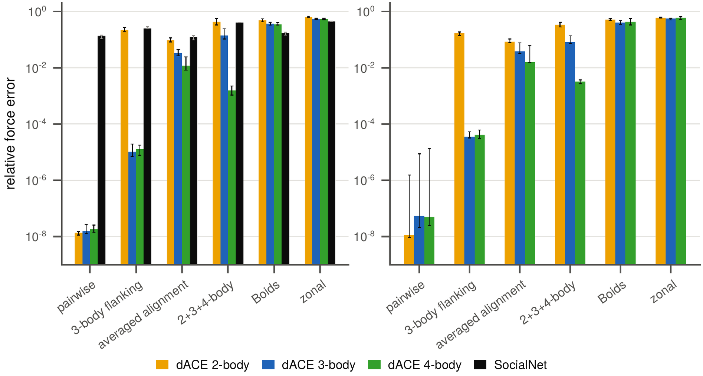
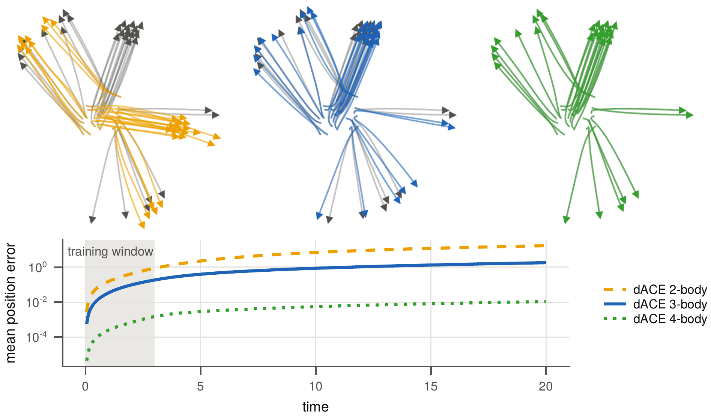

# Reproducing the paper

The scripts under `scripts/` and the `dACESwarms` subpackage, which simulates collectives with
known interaction rules, produce the dACE content of every figure, table and number of the
paper.

```sh
julia --project=. -e 'using Pkg; Pkg.instantiate()'
```

## Benchmarks

```sh
julia -t auto --project=scripts/paper scripts/paper/figures.jl      # fits, Figures 1, 2, 4–6, Table 1, numbers, videos
julia --project=scripts/paper scripts/paper/fig_recovery.jl         # Figure 3 (without SocialNet), from the results of figures.jl
julia --project=scripts/paper scripts/paper/fig_schematic.jl        # Figure 1 alone
julia --project=scripts/paper scripts/paper/fig_data.jl             # Figure 2 alone
julia -t 5 --project=scripts/paper scripts/paper/timing.jl          # fit and evaluation times, for reference (macOS only)
julia -t 5 --project=scripts/paper scripts/synthetic/chiral.jl      # then fig_chiral.jl: Figure 7
julia -t 5 --project=scripts/paper scripts/synthetic/efficiency.jl  # then fig_efficiency.jl: Figure 8
julia -t 5 --project=scripts/paper scripts/synthetic/stochastic.jl  # then fig_selfpropulsion.jl: Figure 9
```

Figures go to `scripts/paper/figures/`, or to a directory passed as the first argument. The
scripts in `scripts/synthetic` and `scripts/realdata` write their results to a `results/`
folder next to them, which the figure scripts read. `scripts/paper/replot.jl` redraws every
figure from cached data and results without refitting.

Figure 3, the relative force error of every model on every collective, 2D with SocialNet
(left) and 3D (right), and Figure 5, the rollout of the learned 2-, 3- and 4-body models
(left to right) on the 2+3+4-body collective with the mean position error below:





The comparison with SocialNet in the paper uses the authors' code and is not part of this
repository. The rollout videos of the paper are on figshare,
[10.6084/m9.figshare.34831176](https://doi.org/10.6084/m9.figshare.34831176).

## Tracked fish

The tracking data are not part of the repository. Put them under `data/` (or the directory
in `DACE_DATA`):

- `data/shiners_dryad/`: the golden shiner trajectories of Davidson et al. (2021), the
  unpacked Dryad archive [10.5061/dryad.sbcc2fr2h](https://doi.org/10.5061/dryad.sbcc2fr2h),
  one folder per trial. `compact_shiners()` in `scripts/realdata/shiners.jl` compacts it once
  to `data/shiners/<trial>.h5`.
- `data/zebrafish/<video>.h5`: the zebrafish videos of Heras et al. (2019) in the human-validated
  idtracker.ai tracking of Torrents et al. (2026), the `zebrafish_<fish>_<video>.npy` files of the
  benchmark data linked from [idtracker.ai](https://idtracker.ai)
  ([Google Drive](https://drive.google.com/drive/folders/1kAB2CDMmgoMtgFQ_q1e8Y4jhIdbxKhUv)),
  converted by `scripts/realdata/convert_zebrafish.py`. The original tracking of the 2019 paper
  ([Google Drive](https://drive.google.com/drive/folders/1Oq7JPmeY3bXqPXc_oTUwUZbHU-m4uq_5))
  goes to `data/zebrafish2019/` as the second tracking of the cross-tracking test.

```sh
SHINER_GAP=0 julia -t 5 --project=scripts/paper scripts/realdata/shiners_protocol.jl         # leave one trial out; Figure 11 at gap 0
ZEBRAFISH_GAP=0 julia -t 5 --project=scripts/paper scripts/realdata/zebrafish_protocol.jl    # leave one video out, cross-tracking
CONSISTENCY_DATA=shiners julia -t 5 --project=scripts/paper scripts/realdata/consistency.jl   # and zebrafish; then fig_realdata.jl: Figures 10, 11
```

`SHINER_GAP` and `ZEBRAFISH_GAP` take the gaps of the paper (0, 3, 6 frames), `SHINER_R` and
`ZEBRAFISH_R` the cutoffs in body lengths (defaults 3 and 8).

## Installing the simulator separately

```julia
using Pkg
Pkg.add(url="https://github.com/TSGut/dACE.jl", subdir="lib/dACESwarms")
```

## Tests

```sh
julia --project=. -e 'using Pkg; Pkg.test()'
julia --project=lib/dACESwarms -e 'using Pkg; Pkg.test()'
```
